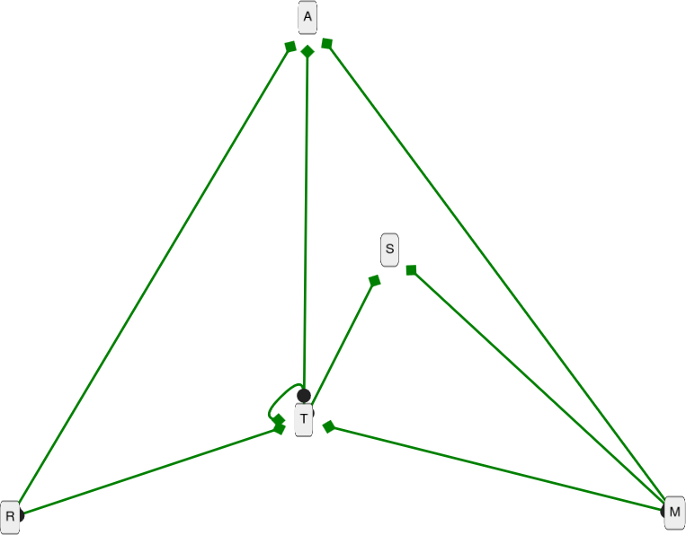
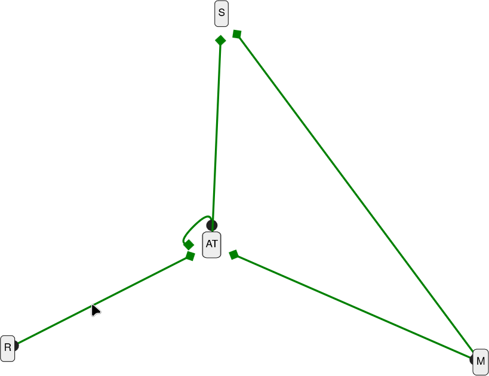
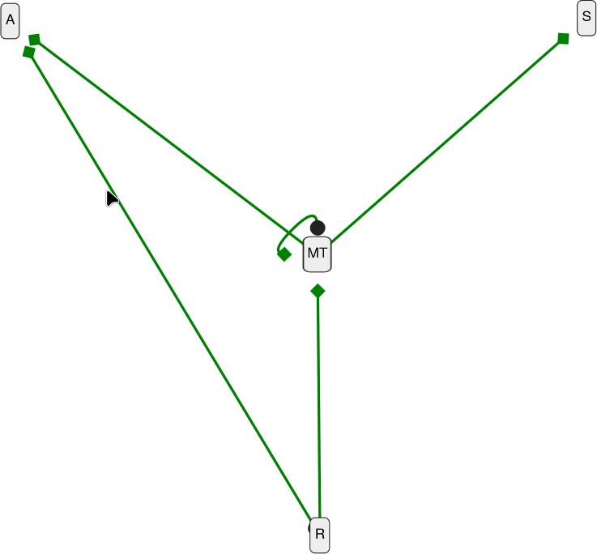

# Conventions

    R = reducer
    M = middleware
    A = action
    T = thunk
    S = selector
    TA = action|thunk

# dépendances

    R>A R>T
    M>A M>T M>S
    T>A T>T T>S

- du bas vers le haut

# dépendances simplifiées

## en regroupant Action et Thunk

Note : même si en réalité, les actions (contrairement aux thunks) n'utilisent pas les actions ni les selecteurs, l'idée est assez proche.

    R>AT
    M>AT M>S
    AT>AT AT>S

- du bas vers le haut

## en regroupant Middleware et Thunk

Note : l'api et le comportement des thunks et des middlewares sont très proches.

    R>A R>MT
    MT>A MT>MT MT>S

- du bas vers le haut

