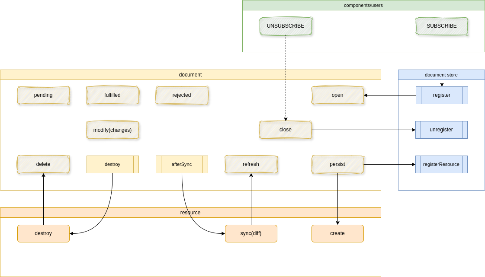

# @lpr/redux-documents

Suivi du cycle de vie de documents JSON:API (Spraypaint) dans Redux, et composants React pour les afficher.

## Principe

- Un **document** enveloppe une resource Spraypaint (et ses `included`). Il est créé par `@lpr/spraypaint-toolkit` (`client.adapt(data)`) et émet des signaux : `open`, `modify`, `pending`, `fulfilled`, `rejected`, `persist`, `close`…
- Les documents **ne sont pas normalisés** : chacun reste autonome. Redux ne garde que leur état de suivi (`version`, `deleted`, `subscriptions`). Les instances vivent dans un store externe (`src/documents/store.js`).
- Le store tient un **index des resources** (`resourceId` → documents). Quand une resource change (sync) ou disparaît (destroy), tous les documents qui la contiennent sont notifiés (`REFRESH`, `DELETE`).
- La récupération des données est confiée à **SWR** (`createScope` + `Index` / `Show`). Il n'y a plus de notion de Request dans Redux.



## Installation

```bash
pnpm add @lpr/redux-documents @lpr/rtk @lpr/spraypaint-toolkit swr
```

Dépendance pair : `react` ≥ 19.

## Utilisation

### 1. Slice Redux

```js
import reduxDocuments from '@lpr/redux-documents';
import createReactStore from '@lpr/rtk/react';

export default createReactStore({ slices: [reduxDocuments] });
```

### 2. Scope SWR

```js
import { createScope } from '@lpr/redux-documents/react';

export const machineScope = createScope(client, { endpoint: '/machines', method: 'all' });
```

Un scope se spécialise avec `extend({...})`. Chaque clé de la requête est appliquée comme méthode du scope Spraypaint (`include`, `where`, `order`, `per`, `page`, `stats`…).

### 3. Observer un document

`Watch` crée le document, s'abonne au montage, se désabonne au démontage, et fournit un contexte au `Controller`.

```jsx
import { Watch } from '@lpr/redux-documents/react';

export const Machine = Watch(client, MachineController, machineContext);
```

Dans le contexte : `data` (attributs, relations, `errors`) et `meta` (`modify`, `commit`, `destroy`, `dirty`, `persisted`, `committing`, `error`).

### 4. Lister / afficher

```jsx
import { Index, Show } from '@lpr/redux-documents/react';

<Index
  scope={machineScope}
  Obs={Machine}
  request={{ include: ['interfaces'] }}
  pager={usePager}
  shouldRefresh={(action, payload) => action === 'create' && payload.type === 'machines'}
/>

<Show scope={machineScope} Obs={Machine} request={{ method: 'find', id }} />
```

Voir [docs/react.md](docs/react.md).

## Documentation

- [Concepts](docs/concepts.md)
- [Cycle de vie](docs/lifecycle.md)
- [React](docs/react.md)
- [API](docs/api.md)
